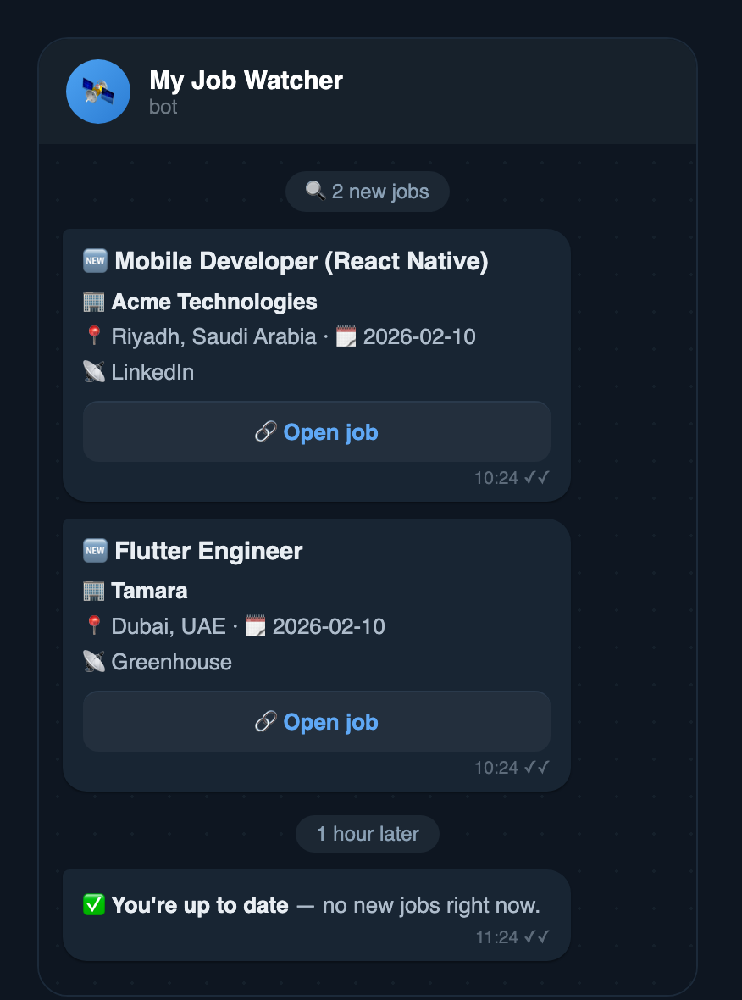

<div align="center">

# 🛰️ JobsWatcher

### Get new job postings delivered straight to your Telegram — automatically.

*Set your keywords once. JobsWatcher scans job sites on a schedule and messages you **only the new matches** — one clean card per job, with a direct link.*

<br>


</div>

---

<div align="center">

### 📬 What your job alerts look like



</div>

---

## ✨ Why JobsWatcher?

| | |
|---|---|
| 🎯 **Only new jobs** | It remembers what it already sent — no spam, no repeats. |
| 🧩 **Multiple sources** | LinkedIn, Remotive (remote jobs), and employer boards (Greenhouse, Lever, Workable, SmartRecruiters, Ashby). |
| ⚡ **Fast** | All sources are fetched **in parallel**. |
| 🪶 **Zero install pain** | Pure Python standard library — **no `pip install` of anything**. |
| 🛠️ **One config file** | Change keywords, locations, sources — all in `config.json`. |
| 🧑‍💻 **For anyone** | Developer, designer, marketer, accountant… same tool, different keywords. |

---

## 🎯 Works for *any* job — just change the keywords

<table>
<tr>
<td>

**📱 Mobile Developer**
```json
["flutter", "react native",
 "android developer", "ios developer"]
```

</td>
<td>

**🛡️ Cybersecurity**
```json
["penetration tester", "SOC analyst",
 "cyber security", "VAPT"]
```

</td>
<td>

**🎨 Designer**
```json
["ui ux designer", "product designer",
 "graphic designer"]
```

</td>
</tr>
</table>

---

## 🚀 Quick Start — step by step

> 🕒 Takes ~5 minutes. You only need **Python 3.9+** and a **Telegram account**.

### 1️⃣ Get the code

```bash
git clone https://github.com/ashrafmohammedsalih/JobsWatcher.git
cd JobsWatcher
cp config.example.json config.json
```

### 2️⃣ Create your Telegram bot 🤖

1. Open Telegram and search for **`@BotFather`** (the official one, with the blue check).
2. Send **`/newbot`**.
3. Give it a **name** (e.g. `My Job Watcher`) and a **username** ending in `bot` (e.g. `my_job_watcher_bot`).
4. BotFather replies with a **token** like `123456:ABC-DEF...` → **copy it.**
5. Open `config.json` and paste it into `telegram.bot_token`.

### 3️⃣ Find your Chat ID 🆔

1. In Telegram, **search for your new bot** and send it any message (e.g. `hi`).
2. Back in the terminal, run:
   ```bash
   python3 -m jobswatcher --whoami
   ```
3. It prints your **chat id** (a number) → paste it into `config.json` → `telegram.chat_id`.

### 4️⃣ Set what you're looking for 🎯

Edit `config.json`:

```json
"search": {
  "keywords":  ["flutter", "react native", "mobile developer"],
  "exclude_title_terms": ["senior", "intern"],
  "locations": ["Saudi Arabia", "United Arab Emirates", "Remote"],
  "jobage_days": 7
}
```

> 💡 **Tip:** use short terms. `"flutter"` matches *Flutter Engineer*, *Senior Flutter Developer*, *Mobile Dev (Flutter)*. A long phrase like `"flutter developer"` matches almost nothing.

### 5️⃣ First run — seed so you don't get flooded 🌱

```bash
python3 -m jobswatcher --init
```
This marks all *current* jobs as "already seen" and sends nothing. From now on you'll only receive **new** ones.

### 6️⃣ Run it — jobs arrive in Telegram! 🎉

```bash
python3 -m jobswatcher
```

Run that on a schedule (next section) and you're done. Want to preview first without sending?

```bash
python3 -m jobswatcher --dry-run
```

---

## ⏰ Keep it running 24/7

Pick whichever fits you — all do the same thing: scan on a schedule, send only new jobs.

### 🐳 Docker — recommended (one command, runs anywhere)

The image **self-schedules** (loops every `RUN_EVERY_MIN` minutes) and keeps its "seen" state in a mounted `data/` folder. No cron, no Python setup.

```bash
# 1. configure
cp config.example.json config.json      # set keywords + telegram token/chat_id

# 2. seed once (so the first run doesn't flood you)
docker compose run --rm jobswatcher python -m jobswatcher --init

# 3. run forever
docker compose up -d
```

Check it:
```bash
docker compose logs -f        # watch it work
docker compose down           # stop
```

> Change the frequency by editing `RUN_EVERY_MIN` in `docker-compose.yml`.
> Prefer plain Docker? `docker build -t jobswatcher . && docker run -d --restart unless-stopped -v $(pwd)/config.json:/app/config.json:ro -v $(pwd)/data:/app/data jobswatcher`

### ☁️ GitHub Actions — free cloud, no server at all

Run it on GitHub's infrastructure for free:
1. Put your keywords/locations in `config.example.json` (no secrets).
2. Repo → **Settings → Secrets and variables → Actions** → add `TELEGRAM_BOT_TOKEN` and `TELEGRAM_CHAT_ID`.
3. **Actions** tab → **JobsWatcher** → **Run workflow** with **seed = true** once, then it runs on schedule.

Workflow is already included at [`.github/workflows/watch.yml`](.github/workflows/watch.yml) (every 30 min; state persists via cache).

<details>
<summary><b>🐧 Other options — cron / systemd</b></summary>

**cron** (every 15 min):
```cron
*/15 * * * * cd /path/to/JobsWatcher && /usr/bin/python3 -m jobswatcher >> data/cron.log 2>&1
```

**systemd** (server/VPS): ready-made units in [`deploy/DEPLOY.md`](deploy/DEPLOY.md).
</details>

---

## ⚙️ Configuration reference

<details>
<summary>Click to expand the full options table</summary>

| Key | What it does |
|-----|--------------|
| `telegram.bot_token` | Token from @BotFather (or env `TELEGRAM_BOT_TOKEN`) |
| `telegram.chat_id` | Your id from `--whoami` (or env `TELEGRAM_CHAT_ID`) |
| `search.keywords` | Roles you want — short, title-friendly terms |
| `search.exclude_title_terms` | Titles to drop (`"senior"`, `"intern"`, …) |
| `search.locations` | Where to search on LinkedIn (`"Remote"` works) |
| `search.location_terms` | *Optional* extra filter: keep a job only if its location text contains one of these. `[]` = keep all |
| `search.jobage_days` | Recency on LinkedIn: `1, 3, 7, 14, 30` |
| `search.require_title_match` | `true` = keyword must be in the **title**; `false` = anywhere |
| `sources.linkedin.enabled` | LinkedIn on/off |
| `sources.linkedin.min_interval_minutes` | Throttle LinkedIn (protects your IP) |
| `sources.remotive.enabled` | Free remote-jobs source on/off |
| `sources.ats.*` | Company slugs per ATS platform (+ `enabled: true`) |
| `options.max_send_per_run` | Cap messages per run (overflow is seeded, not lost) |
| `options.dedup_similar` | Collapse the same role across sources/cities |
| `options.idle_notice_minutes` | `>0` sends a periodic "you're up to date" ping |
| `options.request_delay_seconds` | Politeness delay between requests |

**Adding employer boards (ATS):** from a careers URL like `boards.greenhouse.io/`**`acme`**, add `"acme"` to `sources.ats.greenhouse` and set `sources.ats.enabled: true`.
</details>

---

## 🔌 Sources (all free, no keys)

| Source | Type | Notes |
|--------|------|-------|
| **LinkedIn** | public job search | keyword × location; throttled; personal use only |
| **Remotive** | free API | worldwide remote jobs |
| **Greenhouse / Lever / Workable / SmartRecruiters / Ashby** | employer boards | add the company slugs you care about |

> Want **Indeed, Glassdoor, or Bayt/GulfTalent**? Those need a paid scraping API — add them as a new source plugin (one file).

---

## 🧩 Project structure

```
jobswatcher/
├── __main__.py     # CLI: run · --dry-run · --init · --whoami
├── config.py       # dynamic JSON config + env secrets
├── models.py       # the Job schema
├── pipeline.py     # collect → filter → dedup → de-seen → deliver
├── filters.py      # keyword / exclude / location matching
├── dedup.py        # cross-source de-duplication
├── state.py        # persistent "seen" store + throttles
├── telegram.py     # Telegram delivery
└── sources/        # one plugin per source (fetched in parallel)
    ├── base.py · linkedin.py · ats.py · remotive.py
```
➕ Adding a source = **one file + one line** in `sources/__init__.py`.

---

## 🧰 Troubleshooting

<details>
<summary><b>I'm not getting any messages</b></summary>

- Did you message your bot **first**? `--whoami` only shows your id after you've sent the bot a message.
- Check `data/jobswatcher.log` — it prints `collected X → Y matched → Z new` each run.
- `0 matched`? Your keywords are too narrow — use shorter terms (see the tip above).
</details>

<details>
<summary><b>LinkedIn returns nothing</b></summary>

LinkedIn rate-limits by IP. Keep `min_interval_minutes` at 30+, and don't run too often from a server IP. Remotive and ATS boards have no such limit.
</details>

<details>
<summary><b>Is this against any Terms of Service?</b></summary>

LinkedIn reads public pages; automated access is against their ToS, so keep volume low — **personal use only**. Remotive and ATS boards offer public APIs intended for this.
</details>

---

## 🤝 Contributing

PRs welcome! The cleanest contribution is a **new source** — copy `sources/remotive.py`, implement `fetch()`, register it. Keep it dependency-free.

## 📜 License

**MIT** © Ashraf Mohammed Salih — see [LICENSE](LICENSE). Use it, fork it, make it yours.

<div align="center">
<br>
<sub>Built with Python and ❤️ · If this helped your job hunt, drop it a ⭐</sub>
</div>
